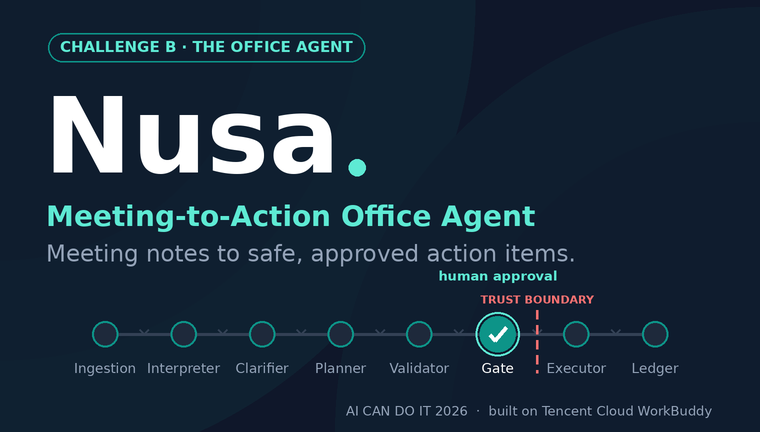

# Nusa — Meeting to Action Office Agent

> Meeting notes to safe, approved action items.



**Challenge B · The Office Agent · Scenario: Meeting to Action**
AI CAN DO IT — Tencent Cloud Hackathon Indonesia 2026, built on Tencent Cloud WorkBuddy.

## About the Name

*Nusa* — from *Nusantara*, the Indonesian archipelago — reflects an agent built for
Indonesian workplaces: bilingual (Bahasa Indonesia / English), time-zone aware
(WIB / WITA / WIT), and respectful of local culture such as Friday prayers.

## What Nusa Does

Nusa converts a meeting note or voice note into:

1. **Structured minutes**
2. **Action items** (who / what / when / where, each traced to a verbatim source quote)
3. **Follow-up messages** (drafted, not sent)

…then presents a **confirmation card** and executes **nothing** until a human
approves the exact details. Every step is logged in an audit ledger.

## Accountability by Design

Nusa is built around the hackathon's five accountability rules:

| Rule | How Nusa satisfies it |
|---|---|
| Shows its sources | Every action item carries a verbatim quote from the source note |
| Stays within permissions | Contact resolution only from the authorized contacts table; operational rules enforced |
| Asks before acting | Hard approval gate — no send/book/create before explicit confirmation |
| Admits its limits | Clarifying-question ladder; says "I don't know"; flags injection attempts |
| Keeps a record | Audit ledger: requested → parsed → clarified → approved/rejected → executed |

## Repository Structure

```
docs/
  Nusa_Prompt_Design.md   # Complete prompt design kit (architecture + prompts)
```

## Documentation

See [`docs/Nusa_Prompt_Design.md`](docs/Nusa_Prompt_Design.md) for the full design:
agent architecture, the six production prompts (Orchestrator, Interpreter,
Clarifier, Planner, Validator, Approval Gate / Executor), example-test
walkthroughs, and the submission checklist.

## Live Demo

Try the interactive pipeline demo (bonus project link):

**https://a18b9216fa13556de.apps.workbuddy.host/?sharecode=WLM3UAMUVB**

Paste a meeting note (or pick a sample) and walk through Interpreter →
Clarifier → confirmation card → mock execution with the live audit ledger.
Try replying "ok" on the approval step — it will be refused.

## Submission Materials

All required hackathon deliverables live in this repo (see `docs/Submission_Package.md` for the
full requirement → artifact index):

| Item | File |
|---|---|
| Prompt design kit (architecture + prompts) | `docs/Nusa_Prompt_Design.md` |
| Architecture diagram (trust boundaries, 1 page) | `docs/Nusa_Architecture_Diagram.pdf` |
| Architecture deck (8 slides, trust boundaries) | `docs/Nusa_Architecture_Presentation.pdf` |
| **Accountability sheet** (trust contract, 1-pager) | `docs/Accountability_Sheet.md` · `docs/Accountability_Sheet.pdf` |
| Test results (10/10, with screenshot checklist) | `tests/tests.md` |
| Demo video script (5–8 min) | `docs/Demo_Video_Script.md` |
| Project description (form-ready, 4 sections) | `docs/Project_Description.md` |
| Submission package index | `docs/Submission_Package.md` |
| Development log (evidence of use) | `docs/Development_Log.md` |
| Live demo (bonus project link) | [README → Live Demo](#live-demo) |

**Short blurb:** *Meeting notes to safe, approved action items.*

## Collaboration

- `main` is protected by convention — please work on feature branches
  (`feature/<name>`) and open pull requests
- Keep all prompts in English; keep Indonesian examples where they reflect
  real usage
- Every change to a prompt should note *why* in the commit message

## Timeline

- **1 Nov 2026** — Submission deadline
- **10 Nov 2026** — Finalist announcement
- **27 Nov 2026** — Demo Day & Award Ceremony
